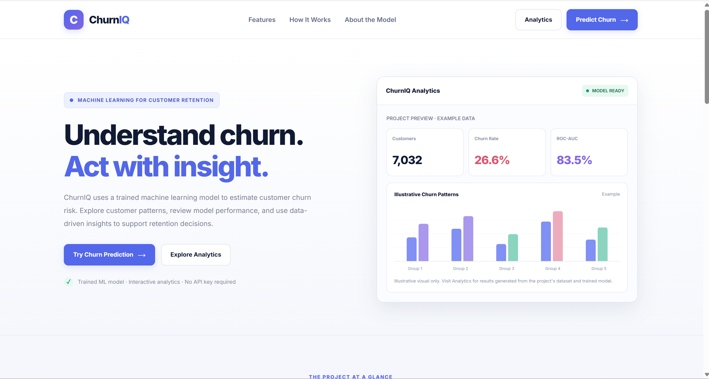
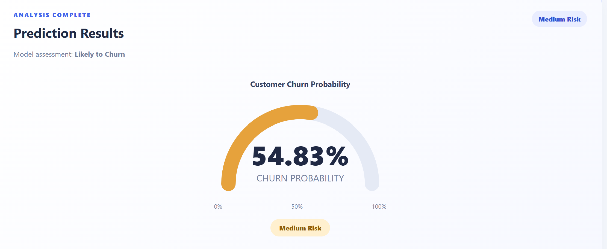
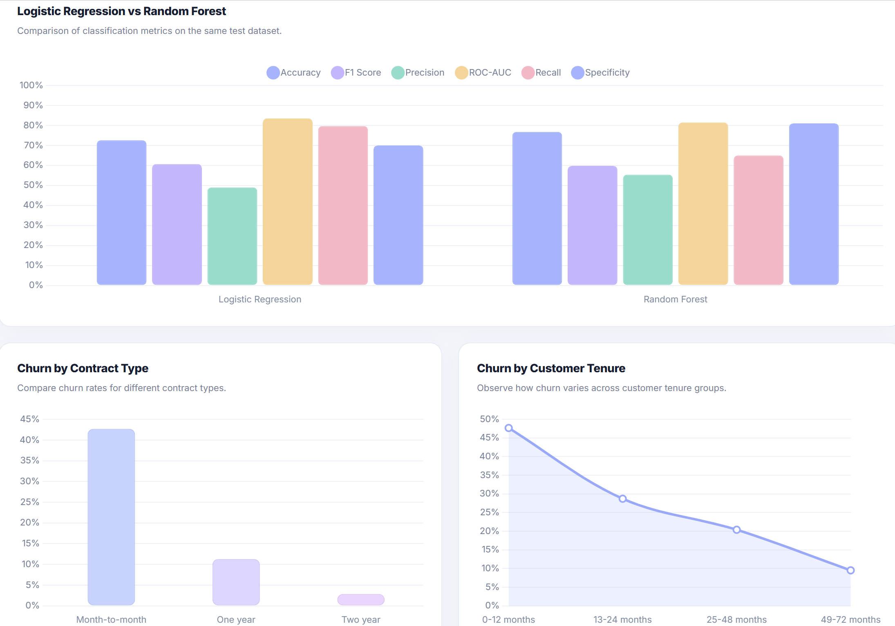

# ChurnIQ — Customer Retention Intelligence Platform

ChurnIQ is a machine-learning-based customer retention platform that predicts the likelihood of telecom customer churn. It combines customer-level risk prediction, rule-based retention recommendations, and an analytics dashboard to help users explore churn patterns and evaluate model performance.

**Live Demo:** https://churniq-mn9u.onrender.com

**GitHub Repository:** https://github.com/vanshikabhardwaj20/ChurnIQ

## Key Features

- **Customer Churn Prediction:** Estimates the probability that a customer will leave.
- **Churn Risk Classification:** Groups customers into Low, Medium, or High risk categories.
- **Personalized Retention Recommendations:** Generates rule-based suggestions using customer characteristics such as contract type, tenure, technical support, and online security subscriptions.
- **Interactive Analytics Dashboard:** Presents customer statistics, churn patterns, model metrics, and churn-related factors.
- **Model Comparison:** Compares Logistic Regression and Random Forest using multiple evaluation metrics.
- **Model Evaluation:** Reports accuracy, precision, recall, F1-score, ROC-AUC, and other performance measures.
- **Input Validation:** Validates customer information submitted through the prediction form.
- **Automated Testing:** Uses pytest to test application routes and prediction functionality.

## Screenshots

### Homepage



### Customer Churn Prediction



### Analytics Dashboard



## Technology Stack

| Category | Technologies |
|---|---|
| Programming Language | Python |
| Web Framework | Flask |
| Data Processing | Pandas, NumPy |
| Machine Learning | Scikit-learn |
| Model Persistence | Joblib |
| Visualization and Analysis | Matplotlib, Seaborn |
| Frontend | HTML, CSS, JavaScript |
| Interactive Charts | Chart.js |
| Testing | Pytest |

## How It Works

1. **Data Preparation:** Cleans the customer dataset and prepares the target variable for model training.
2. **Preprocessing:** Uses a Scikit-learn pipeline to apply preprocessing to the input features.
3. **Model Training:** Trains a Logistic Regression classifier with class weighting to address the imbalance between churn and non-churn customers.
4. **Prediction:** Estimates churn probability for submitted customer information.
5. **Risk Assessment:** Assigns a risk category using predefined probability thresholds.
6. **Retention Recommendations:** Applies predefined business rules to suggest possible retention actions.
7. **Analytics:** Displays customer statistics, churn patterns, model evaluation results, and model comparisons.

The application is designed as a decision-support prototype. Predictions identify potential churn risk; they do not establish that a customer will definitely leave.

## Model Performance

The current production model is Logistic Regression.

### Logistic Regression — Evaluation Results

| Metric | Result |
|---|---:|
| Accuracy | 72.57% |
| Precision | 49.01% |
| Recall | 79.68% |
| F1-score | 60.69% |
| ROC-AUC | 83.51% |

These results come from the project's current evaluation run.

**Interpreting the results:**

- **Accuracy:** The proportion of all predictions that were correct.
- **Precision:** Of the customers predicted to churn, the proportion who actually churned in the evaluation data.
- **Recall:** Of the customers who actually churned, the proportion identified by the model.
- **F1-score:** The harmonic mean of precision and recall.
- **ROC-AUC:** Measures how well the model distinguishes between churn and non-churn customers across classification thresholds.

Recall is particularly relevant to churn detection because missing customers who are about to leave may reduce the opportunity for retention efforts. However, precision also matters because incorrectly flagging customers can lead to unnecessary interventions.

### Model Comparison

The project also evaluates Random Forest on the same train/test split.

| Metric | Logistic Regression | Random Forest |
|---|---:|---:|
| Accuracy | 72.57% | 76.76% |
| Precision | 49.01% | 55.35% |
| Recall | 79.68% | 64.97% |
| F1-score | 60.69% | 59.78% |
| ROC-AUC | 83.51% | 81.46% |
| Specificity | 69.99% | 81.03% |

Logistic Regression achieves higher recall and ROC-AUC in this evaluation, while Random Forest achieves higher accuracy, precision, and specificity. Logistic Regression remains the production model because the current project emphasizes identifying a larger proportion of actual churners.

These metrics describe performance on the evaluation split; they do not guarantee similar performance on unseen real-world populations.

## Dataset

This project uses the IBM Telco Customer Churn dataset.

- **Original records:** 7,043
- **Records after cleaning:** 7,032
- **Records removed:** 11 rows with missing `TotalCharges` values
- **Target variable:** `Churn`
- **Prediction objective:** Estimate whether a customer will churn.

The `customerID` column is excluded from model training because it is an identifier rather than a meaningful customer-behaviour feature.

The dataset is used for experimentation and evaluation. Applying the model to another company's customers would require appropriate data mapping, validation, and potentially retraining.

## Project Structure

```text
ChurnIQ/
├── data/
│   └── Telco-Customer-Churn.csv
├── models/
│   ├── churn_model.joblib
│   ├── feature_importance.csv
│   ├── model_metrics.json
│   ├── model_comparison.csv
│   └── model_comparison.png
├── notebooks/
├── static/
├── templates/
│   ├── home.html
│   ├── index.html
│   └── dashboard.html
├── screenshots/
│   ├── homepage.png
│   ├── prediction.png
│   └── dashboard.png
├── tests/
│   └── test_app.py
├── app.py
├── train_model.py
├── evaluate_model.py
├── compare_models.py
├── dashboard.py
├── requirements.txt
├── .gitignore
└── README.md
```

This structure describes the main project files; additional files may be present in the repository.

## Installation and Setup

### 1. Clone the repository

```bash
git clone https://github.com/vanshikabhardwaj20/ChurnIQ.git
cd ChurnIQ
```

### 2. Create a virtual environment

```bash
python -m venv .venv
```

Activate it on Windows PowerShell:

```powershell
.\.venv\Scripts\Activate.ps1
```

### 3. Install dependencies

```bash
pip install -r requirements.txt
```

### 4. Run the application

```bash
python app.py
```

Open the application in your browser:

- **Homepage:** http://127.0.0.1:5000/
- **Customer Prediction:** http://127.0.0.1:5000/predict
- **Analytics Dashboard:** http://127.0.0.1:5000/dashboard

Keep the terminal running while using the application.

## Running Tests

Run the automated test suite:

```bash
python -m pytest -v
```

The current test suite contains five tests covering page loading, dashboard loading, input validation, unknown routes, and valid customer predictions. All five tests passed in the latest reported run.

## Limitations

- Predictions represent estimated risk, not certainty.
- Retention recommendations use predefined rules; they are not generated by a generative AI model.
- The model was evaluated on a specific telecom dataset and may not generalize to other customer populations.
- The effectiveness of retention recommendations has not been established through real-world controlled experiments.
- This project is a decision-support prototype, not a guarantee of customer retention.

## Future Improvements

- Calibrate predicted probabilities and tune classification thresholds.
- Add customer-level feature explanations.
- Expand historical churn trend analysis.
- Evaluate retention recommendations through controlled experiments.
- Support uploading new customer datasets with validation.
- Add deployment monitoring and model-drift detection.

## Author

Developed as a machine-learning and data analytics project focused on customer churn prediction, model evaluation, and retention insights.
